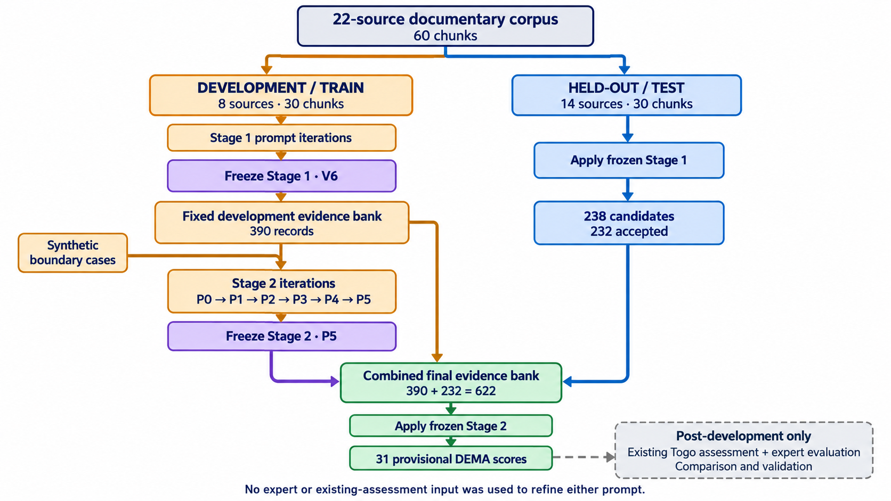

# Simple research workflow

- Prompt development used only the eight-source development set.
- The 14-source set was held out until Stage 1 had been frozen.
- The existing Togo assessment and expert evaluations were introduced only after prompt development; they did not refine either prompt.
